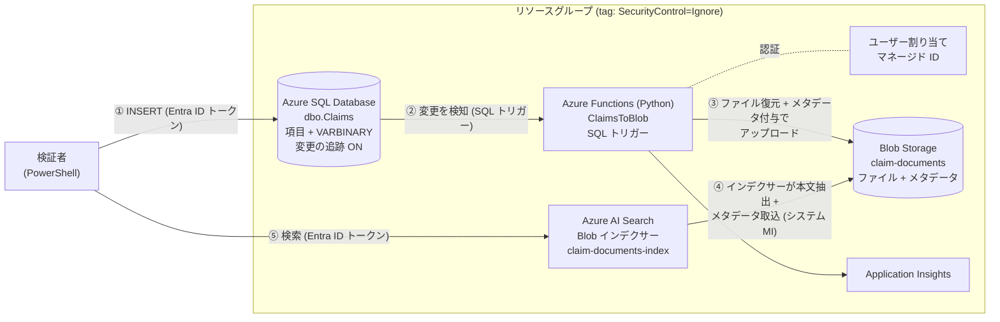

# SQL Database の VARBINARY ファイル → Blob Storage → Azure AI Search 検証環境

Azure SQL Database に **VARBINARY 型で格納されたファイル (報告資料・添付資料)** と **各種項目 (クレーム情報・発生事象など)** が 1 レコードにまとまっているデータを、
Blob Storage 経由で Azure AI Search のインデックスに取り込み、**資料本文とクレーム情報の両方で検索できる**ことを検証するためのプロジェクトです。

---

## 1. 目的

- 既存システム (SQL Server) に「項目 + ファイル本体」の形で蓄積されているクレーム関連データを、全文検索可能にするアーキテクチャを検証する。
- SQL Server のデータを直接 AI Search に取り込むのではなく、**ファイルは Blob として復元し、その他の項目は Blob メタデータとして付与**したうえで、
  **AI Search の Blob インデクサー**で「文書本文の抽出 (PDF / Word / Excel)」と「メタデータのフィールド化」を同時に行う方式の妥当性を確認する。
- 認証はすべて **Microsoft Entra ID + マネージド ID + RBAC** とし、キー・パスワード・接続文字列のシークレットを一切使わない構成で成立することを確認する。

## 2. 検証内容

| # | 検証項目 | 確認方法 |
|---|---|---|
| 1 | SQL Database へのレコード登録をトリガーに Azure Functions が起動すること (SQL トリガー / 変更の追跡) | `Register-SampleData.ps1` 実行後、Application Insights / ログストリームで `ClaimsToBlob` の実行ログを確認 |
| 2 | VARBINARY のバイナリから元のファイル (PDF / docx / xlsx) を正しく復元できること | Blob をダウンロードしてファイルが開けることを確認 |
| 3 | 日本語を含む項目を Blob メタデータとして保持できること (メタデータは ASCII 制約あり) | Blob のメタデータに URL エンコード値が付与されていることを確認 |
| 4 | Blob インデクサーで本文抽出 + メタデータのフィールド化 (`urlDecode`) ができること | `Invoke-Indexer.ps1` の結果、インデックスのドキュメント数 = 6 |
| 5 | 本文キーワード・項目フィルターで検索できること | `Search-Documents.ps1 -Query '硬度不足'` などで該当資料がヒットすること |
| 6 | 手作業による RBAC 設定・シークレット登録・マネージド ID 有効化が不要なこと | `deploy.ps1` のみで構築が完了すること |

## 3. アーキテクチャ



### 処理の流れ

1. 検証者が `Register-SampleData.ps1` で SQL Database の `dbo.Claims` に 1 ファイル = 1 レコードとして登録する。
2. Functions の **SQL トリガー**が変更の追跡 (Change Tracking) で新規行を検知し、行データ (VARBINARY は Base64) を関数に渡す。
3. 関数がレコードごとに
   - `FileData` (VARBINARY) を Base64 デコードしてファイルとして復元し、
   - その他の列を Blob メタデータ (日本語は URL エンコード) に変換し、
   - `claim-documents/{ClaimNumber}/{ClaimId}_{FileName}` に Content-Type 付きでアップロードする。
4. AI Search の **Blob インデクサー** (5 分間隔) が Blob 本文 (PDF / Word / Excel) からテキストを抽出し、カスタムメタデータを `urlDecode` で復号してインデックスのフィールドに格納する。
5. 本文の全文検索とクレーム情報によるフィルター / ファセットが可能になる。

## 4. 構成リソース

すべて `infra/main.bicep` で作成します (リソースグループおよび全リソースに `SecurityControl: Ignore` タグを付与)。

| リソース | SKU / 設定 | 用途 |
|---|---|---|
| リソースグループ | tag `SecurityControl: Ignore` | 検証環境一式 |
| Azure SQL Server / Database | Basic, **Entra ID 認証のみ** | クレーム情報 + VARBINARY ファイルの格納元 (SQL Server の代替) |
| Storage Account | Standard_LRS, **共有キー無効**, パブリックアクセス無効 | Functions ホスト用 + 資料格納コンテナー `claim-documents` |
| App Service プラン (Linux) | B1 (Always On) | Functions の実行基盤 (SQL トリガーを常時ポーリング) |
| Function App | Python 3.11, Functions v4 | `ClaimsToBlob` 関数 |
| ユーザー割り当てマネージド ID | `id-func-*` | Functions → SQL / Storage の認証 |
| Azure AI Search | Basic, **API キー無効 (RBAC のみ)**, システム割り当て MI | インデックス / インデクサー |
| Log Analytics / Application Insights | - | Functions のログ確認 |

## 5. 認証・権限設計 (シークレットレス)

| 呼び出し元 | 呼び出し先 | 認証方式 | 権限 | 設定箇所 |
|---|---|---|---|---|
| Functions (UAMI) | Storage (ホスト用) | ID ベース接続 `AzureWebJobsStorage__*` | Storage Blob Data Owner / Queue Data Contributor / Table Data Contributor | Bicep |
| Functions (UAMI) | Storage (資料アップロード) | `DefaultAzureCredential` (`AZURE_CLIENT_ID`) | Storage Blob Data Owner に包含 | Bicep |
| Functions (UAMI) | SQL Database | `Authentication=Active Directory Managed Identity` | db_datareader / db_datawriter / db_ddladmin / VIEW CHANGE TRACKING | `Initialize-Database.ps1` (deploy.ps1 から自動実行) |
| AI Search (システム MI) | Storage | データソース接続文字列 `ResourceId=...` | Storage Blob Data Reader | Bicep |
| デプロイ実行者 | SQL Database | Entra ID トークン | **SQL の Entra 管理者** | Bicep |
| デプロイ実行者 | AI Search | Entra ID トークン | Search Service Contributor / Search Index Data Reader | Bicep |
| デプロイ実行者 | Storage | Entra ID | Storage Blob Data Contributor (結果確認用) | Bicep |

> **SQL のデータベースユーザーについて**  
> SQL Database 内のユーザー作成 (`CREATE USER`) は ARM / Bicep の管理対象外 (データプレーン操作) のため、`deploy.ps1` が Bicep デプロイ直後に `Initialize-Database.ps1` を自動実行して作成します。
> UAMI のクライアント ID を SID に指定する `CREATE USER ... WITH SID = ..., TYPE = E` 構文を使うため、SQL サーバー側に Microsoft Graph の参照権限 (Directory Readers) を付与する必要もありません。
> AI Search のインデックス等の作成も同様にデータプレーン操作のため `Initialize-SearchIndex.ps1` で自動作成します。**いずれも手作業は不要です。**

## 6. データモデル

### 6.1 SQL Database `dbo.Claims` ([sql/schema.sql](sql/schema.sql))

| 列 | 型 | 内容 | Blob メタデータキー | エンコード |
|---|---|---|---|---|
| ClaimId | INT IDENTITY (PK) | レコード ID | `claim_id` | なし |
| ClaimNumber | NVARCHAR(20) | クレーム番号 | `claim_number` | URL |
| ReceivedDate | DATE | 受付日 | `received_date` | なし (ISO 8601 UTC) |
| CustomerName | NVARCHAR(100) | 顧客名 | `customer_name` | URL |
| ProductName | NVARCHAR(100) | 製品名 | `product_name` | URL |
| LotNumber | NVARCHAR(50) | 製造ロット | `lot_number` | URL |
| ClaimCategory | NVARCHAR(50) | クレーム区分 | `claim_category` | URL |
| Severity | NVARCHAR(10) | 重要度 | `severity` | URL |
| IncidentDate | DATE | 発生日 | `incident_date` | なし (ISO 8601 UTC) |
| IncidentSummary | NVARCHAR(1000) | 発生事象 | `incident_summary` | URL |
| Status | NVARCHAR(20) | 対応状況 | `status` | URL |
| DocumentType | NVARCHAR(20) | 資料種別 (報告資料 / 添付資料) | `document_type` | URL |
| FileName | NVARCHAR(260) | 元ファイル名 | `file_name` | URL |
| ContentType | NVARCHAR(100) | MIME タイプ | (Blob の Content-Type に設定) | - |
| FileData | VARBINARY(MAX) | ファイル本体 | (Blob 本体として復元) | - |

### 6.2 AI Search インデックス `claim-documents-index` ([search/index.json](search/index.json))

- `content` : インデクサーが PDF / Word / Excel から抽出した本文 (`ja.microsoft` アナライザー)
- 上表のメタデータ各フィールド : `urlDecode` で復号して格納 ([search/indexer.json](search/indexer.json) の `fieldMappings`)
- `metadata_storage_*` : Blob 名・パス・サイズ・更新日時などの標準メタデータ
- キー `id` : `metadata_storage_path` を Base64 エンコードした値

### 6.3 サンプルデータ ([sample-data/](sample-data/))

架空の製造業者「サンプル精機株式会社」が受け付けた 3 件のクレームと、それぞれの報告資料・添付資料 (計 6 ファイル) です。

| クレーム番号 | 顧客 / 製品 | 資料種別 | ファイル |
|---|---|---|---|
| CLM-2026-0001 | 東和食品工業 / 産業用ギアポンプ GP-450 (品質不良・高) | 報告資料 | 不具合調査報告書 (PDF) |
| | | 添付資料 | 測定データ (Excel: 測定結果・圧力推移・所見) |
| CLM-2026-0002 | 北陸ケミカル / 電磁流量計 EMF-200 (計測異常・中) | 報告資料 | 現地調査報告書 (Word) |
| | | 添付資料 | 校正試験成績書 (PDF) |
| CLM-2026-0003 | 南海物流 / 制御盤 CP-7000 (製造不備・高) | 報告資料 | 是正処置報告書 (Word) |
| | | 添付資料 | 配線点検チェックリスト (Excel: 点検結果・是正計画) |

資料は [scripts/sample-docs/generate_sample_documents.py](scripts/sample-docs/generate_sample_documents.py) で生成しています (生成済みファイルをリポジトリに同梱しているため再生成は不要です)。
内容を変更したい場合は次のコマンドで再生成できます。

```bash
pip install -r scripts/sample-docs/requirements.txt
python scripts/sample-docs/generate_sample_documents.py
```

## 7. リポジトリ構成

```
.
├── deploy.ps1                          # 一括構築 (Bicep → SQL 初期化 → AI Search 初期化 → 関数デプロイ)
├── infra/
│   ├── main.bicep                      # サブスクリプションスコープ: リソースグループ (タグ付き) 作成
│   └── resources.bicep                 # 各リソース・マネージド ID・RBAC
├── src/function/                       # Azure Functions (Python v2 プログラミングモデル)
│   ├── function_app.py                 # SQL トリガー → ファイル復元 → Blob アップロード
│   ├── host.json
│   └── requirements.txt
├── sql/schema.sql                      # テーブル作成・変更の追跡の有効化
├── search/                             # AI Search のデータソース / インデックス / インデクサー定義
├── scripts/
│   ├── common.ps1                      # 共通関数 (デプロイ出力取得・SQL 接続・Search REST 呼び出し)
│   ├── Initialize-Database.ps1         # テーブル作成 + Functions MI の DB ユーザー作成 (deploy.ps1 から実行)
│   ├── Initialize-SearchIndex.ps1      # AI Search オブジェクト作成 (deploy.ps1 から実行)
│   ├── Register-SampleData.ps1         # ★ サンプルデータを SQL Database に登録
│   ├── Invoke-Indexer.ps1              # インデクサーの即時実行と結果確認
│   ├── Search-Documents.ps1            # 検索の動作確認
│   └── sample-docs/                    # サンプル資料生成スクリプト
└── sample-data/
    ├── claims.json                     # 登録するレコード定義
    └── documents/                      # PDF / Word / Excel 資料
```

## 8. 前提条件

| ツール | バージョン | 用途 |
|---|---|---|
| [PowerShell](https://learn.microsoft.com/powershell/scripting/install/installing-powershell) | 7.x (`pwsh`) | すべてのスクリプト |
| [Azure CLI](https://learn.microsoft.com/cli/azure/install-azure-cli) | 2.60 以降 (Bicep 同梱) | デプロイ・トークン取得 |
| [Azure Functions Core Tools](https://learn.microsoft.com/azure/azure-functions/functions-run-local) | v4 | 関数コードのデプロイ |

- 実行ユーザーは Microsoft Entra ID の**ユーザー**で `az login` していること (サービスプリンシパルでのログインは非対応)。
- 対象サブスクリプションで **所有者** (またはリソース作成 + ロール割り当てが可能なロール) を持っていること。
- 実行端末から Azure SQL Database (TCP 1433) へ接続できること。

## 9. 利用手順

### 9.1 構築 (一括)

```powershell
az login
az account set --subscription "<サブスクリプション名または ID>"

./deploy.ps1
# リソースグループ名やリージョンを変える場合
# ./deploy.ps1 -ResourceGroupName rg-my-poc -Location japanwest
```

`deploy.ps1` は以下を順に実行します。所要時間はおおむね 10〜15 分です。

1. サインインユーザーのオブジェクト ID / UPN と、実行端末のグローバル IP を取得
2. `infra/main.bicep` をデプロイ (リソースグループ・全リソース・マネージド ID・RBAC・SQL ファイアウォール)
3. `Initialize-Database.ps1` : テーブル作成、変更の追跡の有効化、Functions MI の DB ユーザー作成
4. `Initialize-SearchIndex.ps1` : データソース・インデックス・インデクサー作成 (RBAC 反映待ちは自動リトライ)
5. `func azure functionapp publish` : 関数コードのデプロイ (リモートビルド)

> Bicep だけを単独でデプロイする場合は次のとおりです (その後 3〜5 を個別に実行してください)。
>
> ```powershell
> az deployment sub create --name sql-binary-search-poc --location japaneast `
>   --template-file infra/main.bicep `
>   --parameters principalId=$(az ad signed-in-user show --query id -o tsv) `
>                principalName=$(az ad signed-in-user show --query userPrincipalName -o tsv) `
>                clientIpAddress=<実行端末のグローバル IP>
> ```

### 9.2 データ登録 (Functions の起動)

```powershell
./scripts/Register-SampleData.ps1
# 1 件ずつトリガーの発火を観察したい場合
# ./scripts/Register-SampleData.ps1 -IntervalSeconds 15
```

登録と同時に SQL トリガーが発火し、数秒以内に Blob がアップロードされます。

### 9.3 Blob とメタデータの確認

```powershell
$st = (az deployment sub show -n sql-binary-search-poc --query properties.outputs.storageAccountName.value -o tsv)
az storage blob list --account-name $st -c claim-documents --auth-mode login --include m `
  --query "[].{name:name, size:properties.contentLength, type:properties.contentSettings.contentType, metadata:metadata}" -o jsonc
```

Azure ポータルの Function App → 「ログストリーム」または Application Insights の `traces` で `Uploaded blob. ClaimId=...` のログも確認できます。

### 9.4 インデックス化

インデクサーは 5 分間隔で自動実行されます。すぐに確認したい場合は次を実行します。

```powershell
./scripts/Invoke-Indexer.ps1
# status: success / itemsProcessed: 6 / インデックスのドキュメント数: 6
```

### 9.5 検索

```powershell
# 本文のキーワード検索 (PDF の不具合調査報告書と Excel の測定データがヒット)
./scripts/Search-Documents.ps1 -Query '硬度不足'

# 本文検索 + メタデータによるフィルター
./scripts/Search-Documents.ps1 -Query '接地' -Filter "document_type eq '報告資料'"
./scripts/Search-Documents.ps1 -Query '*' -Filter "severity eq '高' and status ne '完了'"
./scripts/Search-Documents.ps1 -Query '非常停止 配線' -Filter "claim_category eq '製造不備'"
```

Azure ポータルの AI Search →「検索エクスプローラー」からも検索できます (デプロイ実行者に Search Index Data Reader を付与済み)。

### 9.6 後片付け

```powershell
az group delete --name rg-sql-binary-search-poc --yes --no-wait
az deployment sub delete --name sql-binary-search-poc
```

## 10. 設計上のポイント・検証で得られる知見

### Blob 出力バインドではなく SDK でアップロードしている理由
Python の Blob **出力バインド**はコンテンツ (バイト列) の書き込みのみに対応しており、**Blob メタデータや Content-Type を設定できません**。
本検証では「項目をメタデータとして付与する」ことが要件のため、`azure-storage-blob` SDK + `DefaultAzureCredential` (UAMI) でアップロードしています。
認証はバインドと同じくマネージド ID で、キーや接続文字列は使用していません。

### Blob メタデータの制約と対処
- **値は ASCII のみ** (HTTP ヘッダーとして送信されるため)。日本語の項目は関数側で URL エンコード (`urllib.parse.quote`) し、
  インデクサーの `fieldMappings` で **`urlDecode`** を指定して復号しています。日付・ID など ASCII のみの項目はエンコードしていません。
- **キー名 + 値の合計は 8 KB まで**。日本語は URL エンコードで 1 文字 9 バイトになるため、長文項目は上限に達しやすい点に注意が必要です。
  本実装では上限超過時に `incident_summary` (発生事象) を切り詰め、警告ログを出力します。
  長文項目を確実に検索対象にしたい場合は、メタデータではなく JSON のサイドカー Blob や AI Search への直接 push を検討してください。

### SQL トリガーと VARBINARY
- SQL トリガーは**変更行の全列**を JSON で関数に渡すため、VARBINARY の内容も Base64 文字列としてペイロードに含まれます。
  大きなファイルを扱う場合はメモリ・ペイロードサイズに注意が必要なため、`Sql_Trigger_MaxBatchSize=10` で 1 回の処理件数を抑えています。
  数十 MB 級のファイルを扱う本番想定では、トリガーでは主キーのみ受け取り、関数内で `FileData` を個別に取得する方式が安全です。
- SQL トリガーは対象テーブルが存在し変更の追跡が有効でないと起動に失敗するため、`deploy.ps1` では **DB 初期化 → 関数デプロイ** の順で実行しています。
- 関数が例外を送出した場合、SQL トリガーは同じ変更を再試行します (Blob は `overwrite=True` のため冪等)。
- `UPDATE` でも再アップロード (上書き) されます。`DELETE` は主キーしか渡されず Blob 名を特定できないため本検証では対象外としています。

### ホスティングプラン
SQL トリガーはポーリングで変更を検知するため、常時稼働できる **App Service プラン (B1, Always On)** を採用しています。
Storage の共有キーを無効化した状態でも動作するよう、Azure Files を必要としない専用プランとしています。

### SQL の Entra 管理者
SQL サーバーは **Entra ID 認証のみ** (SQL 認証無効) とし、Entra 管理者にはデプロイ実行者を設定しています。
これにより、パスワードを発行せずに登録用 PowerShell から接続でき、Functions 用のデータベースユーザー作成も自動化できます。

### AI Search
- `disableLocalAuth: true` で API キーを無効化し、すべて RBAC で操作します。
- データソースはシステム割り当てマネージド ID (`ResourceId=...;` 形式の接続文字列) で Blob に接続します。
- 本文抽出は `dataToExtract: contentAndMetadata`。Excel はシートのセル値がテキストとして抽出されます。

## 11. トラブルシューティング

| 症状 | 原因と対処 |
|---|---|
| `deploy.ps1` で `az ad signed-in-user show` が失敗する | サービスプリンシパルでログインしている。ユーザーで `az login` し直す |
| SQL 接続でファイアウォールエラー | 実行端末のグローバル IP が変わった / プロキシ経由。`./deploy.ps1 -ClientIpAddress <IP>` で再デプロイ |
| `Initialize-SearchIndex.ps1` が 403 を繰り返す | ロール割り当ての反映待ち (自動で最大 10 分リトライ)。時間をおいて再実行 |
| 登録しても Blob ができない | Function App のログストリームを確認。`Login failed for user '<token-identified principal>'` の場合は `./scripts/Initialize-Database.ps1` を再実行 |
| インデクサーの初回実行が失敗している | AI Search MI の Storage ロール反映前に実行されたため。`./scripts/Invoke-Indexer.ps1` で再実行 |
| Registration で `skip (登録済み)` になる | 同じクレーム番号 + ファイル名が登録済み。再検証する場合は `DELETE FROM dbo.Claims` 後に再登録 (Blob は上書きされる) |
